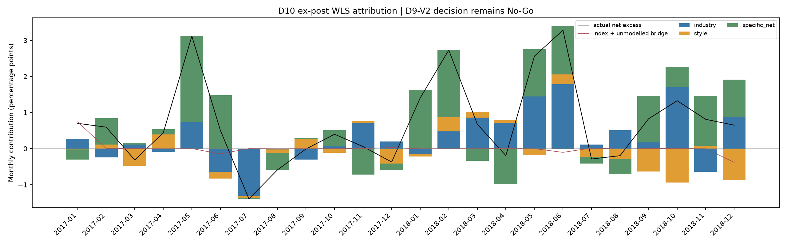

# D10 归因与诊断

**D9-V2：No-Go，结论不变。以下为事后诊断。**

D9-V2 月度年化超额 3.1081%；阶梯 CAGR 差额 3.6190%，两个口径分别保留。

## 阶梯分解（主资金 1000 万）

费前收益为实际持仓路径的费用加回；成本拖累是该路径费前/费后年化差。

| 窗口 | 层 | 净超额 | 费前超额 | 成本拖累 | 目标总换手均值 | 实际换手均值 | 目标强制换手均值 | 目标主动换手均值 | 目标距 w0 均值 | 实际事前距 w0 均值 |
|---|---:|---:|---:|---:|---:|---:|---:|---:|---:|---:|
| design | 0 | 11.39% | 11.39% | 0.00% | 67.33% | 67.03% | 0.38% | 66.95% | 79.74% | 70.92% |
| design | 1 | 5.26% | 11.38% | 6.13% | 67.33% | 66.96% | 0.38% | 66.95% | 79.74% | 70.91% |
| design | 2 | 11.38% | 16.44% | 5.06% | 67.33% | 53.82% | 0.38% | 66.95% | 79.74% | 75.62% |
| design | 3 | 6.86% | 16.00% | 9.14% | 85.23% | 69.69% | 0.39% | 84.84% | 85.23% | 78.18% |
| design | 4 | 3.93% | 12.74% | 8.81% | 84.80% | 71.09% | 0.39% | 84.41% | 84.80% | 77.28% |
| design | 5 | 6.27% | 8.14% | 1.87% | 15.00% | 19.24% | 0.39% | 14.61% | 15.00% | 22.08% |
| design | 6 | 7.64% | 8.86% | 1.21% | 15.00% | 13.41% | 0.39% | 14.61% | 15.00% | 12.93% |
| oos | 0 | 10.46% | 10.46% | 0.00% | 67.02% | 66.95% | 0.34% | 66.68% | 80.04% | 70.92% |
| oos | 1 | 3.07% | 10.46% | 7.38% | 67.02% | 66.89% | 0.34% | 66.68% | 80.04% | 70.91% |
| oos | 2 | 1.31% | 7.92% | 6.60% | 67.02% | 62.71% | 0.34% | 66.68% | 80.04% | 72.18% |
| oos | 3 | -10.32% | 1.15% | 11.47% | 87.25% | 83.39% | 0.41% | 86.84% | 87.25% | 76.82% |
| oos | 4 | -11.55% | -0.38% | 11.17% | 86.86% | 83.74% | 0.41% | 86.45% | 86.86% | 76.39% |
| oos | 5 | 2.42% | 5.25% | 2.83% | 15.41% | 22.68% | 0.41% | 15.00% | 15.41% | 13.67% |
| oos | 6 | 3.62% | 5.30% | 1.68% | 15.41% | 15.09% | 0.41% | 15.00% | 15.41% | 3.27% |

2000 万资金与相邻层的目标/实际持仓距离详见 ladder_decomposition.parquet 和逐信号明细。
实际强制退出按半个卖出腿列示，其余买卖腿单列；不得将这两个数字与 V2 满仓强制退出及替代买入的目标定义混用。

## 第二层反常变化

| 窗口/资金 | L2−L1 月度年化差 | 原持仓路径贡献 | 成交后日内贡献 | 成本节约贡献 |
|---|---:|---:|---:|---:|
| design/10,000,000 | 6.06% | 4.67% | -0.06% | 1.46% |
| design/20,000,000 | 6.30% | 4.66% | -0.06% | 1.70% |
| oos/10,000,000 | -1.85% | -2.40% | 0.00% | 0.55% |
| oos/20,000,000 | -1.74% | -2.40% | 0.00% | 0.65% |

这是两个完整实际路径的精确记账分解，无法单独证明过滤器的因果效果。逐笔费用、状态时间、阻单和股票路径关联已独立落盘。

## 归因

- design：费后特异性占比 72.38%；三块残差年化平均绝对值 0.730%；最差日历年 0.935%；残差验收 False。
- design：指数成分中当日无法定价者出现于 0 天，基准权重最大 0.0000%、平均 0.0000%。这类成分同时退出回归拟合、贡献分解与指数篮子重建，恒等式不受影响，其指数效应留在官方指数桥接里，不计入特异性。

- oos：费后特异性占比 92.88%；三块残差年化平均绝对值 1.195%；最差日历年 2.339%；残差验收 False。
- oos：指数成分中当日无法定价者出现于 279 天，基准权重最大 0.3346%、平均 0.0357%。这类成分同时退出回归拟合、贡献分解与指数篮子重建，恒等式不受影响，其指数效应留在官方指数桥接里，不计入特异性。

特异性净贡献为 WLS 个股残差减去明确披露的真实交易费用；费用前残差也单列。官方指数桥接、未覆盖股票/行业和陈旧暴露的贡献独立披露，不塞进特异性 alpha。

## 压力测试

| 情景 | 月度年化超额 | IR | 最大相对回撤 |
|---|---:|---:|---:|
| impact2x_reused | 2.54% | 0.398 | 11.27% |
| delay_one_day | 2.25% | 0.354 | 12.37% |
| biweekly | 1.54% | 0.256 | 9.70% |

冲击翻倍复用 V2，延迟与双周均为冻结目标的执行排期敏感性，保留现金等待日和主结果全部比较日期；调样滞留权重单列。

## 2026 年 7 月

模型绝对收益 **-10.11%**；中证500全收益指数 **-16.82%**；当月超额 **6.72%**。

## 账本核对

**共 13 项不一致**，已逐条落盘于 `reconciliation_findings.json`；
诊断验收因此判定为未通过。D8 与 D9-V2 文件未被改动，原结果一律保留。

| 窗口 | 资金 | 层 | 不一致项 |
|---|---:|---|---:|
| oos | 10,000,000 | 5 | 2 |
| oos | 10,000,000 | 6 | 2 |
| oos | 10,000,000 | stress_biweekly | 1 |
| oos | 10,000,000 | stress_delay_one_day | 2 |
| oos | 10,000,000 | stress_impact2x | 2 |
| oos | 20,000,000 | 5 | 2 |
| oos | 20,000,000 | 6 | 2 |

## 验收与勘误

诊断验收：False。该值只表示 D10 诊断完整性，不能改变研究 No-Go。
输入前后 SHA256 校验及 frozen-oos 核验详见 completion.json。既有 D1–D9 文件保留；静态发现与口径澄清详见仓库 D10勘误登记.md。
