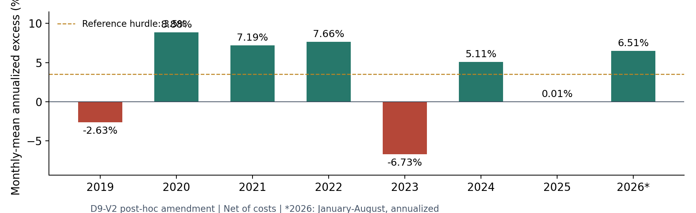
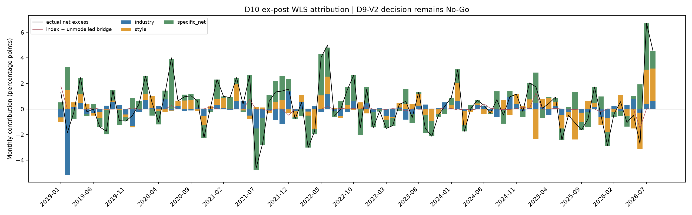

# 中证500指数增强原型：D11研究报告

**报告日：2026-09-05｜拟汇报日：2026-09-15｜结论：No-Go**

依据私有仓库 `Tingfu-Zhou/csi500-research` 的 main 分支提交 `42c8870392a3d45f531cffbefbc138e5d8fbb328`。实际结果目录为 `reports/`。第四版计划是冻结前协议，第五版及D9执行记录是事后收尾指南；本报告结合D10最新证据更新表述，不覆盖原记录。

## 01｜结论：本轮基线不进入资金验证

本轮完成了从数据、打分、组合到回测诊断的研究链路。D9原规则因成分元数据问题和换手约束不可行先后停止；之后明确标记为事后修订的D9-V2完成滚动回测。按原六项门槛作事后对照，**两项通过、四项未通过，结论保持No-Go**。[S01][S02]

{{gates}}

主结果：2019年1月至2026年8月，共92个月；主资金1000万元；费后、相对H00905.CSI全收益指数、月度超额均值乘12的年化口径。92.88%的归因占比依赖当前因子体系，并非独立证实的纯alpha。

**完成工作与通过验收是两件事。** D9-V2的既有工程验收通过；D7事前TE门槛未通过；D10诊断自身仍有两项未通过。D10还确认了预测名单依赖未来标签可用性，以及优化参考持仓使用执行日价格的时点局限。因此，本报告不将回测描述为已排除全部前视问题的可执行业绩证明。[S03][S04]

对张老师的核心结论：当前版本的收益强度和稳定性不足，本月不申请交易资金；先修研究链路，再评估下一版改进的成本和验证路径。**这否定的是当前具体实现进入资金验证的条件，不能据此推断开源模型的收益上限，也不能否定整个量化方向。**

<!-- PAGEBREAK -->

## 02｜研究对象、实现与统计口径

{{method_table}}

重要区别：当前使用Qlib生成Alpha158特征，预测器直接调用LightGBM的`LGBMRegressor`。它不是照搬Qlib官方示例的一整套工作流；当前参数是安装版本默认值，仅固定随机种子。现有优化器只硬约束行业、Size和Beta；D6其余风格暴露用于测量，不等于全部被中性化。[S01][S05][S06]

**主表与阶梯表不能替换。** 每个月先分别复合组合和指数日收益，再相减得到月度超额。主指标为月度超额均值×12；TE为月度超额样本标准差×√12；IR为两者之比。NW-t在lag 3至6中取最低值。最大相对回撤来自组合净值/指数净值的日度回撤。[S07]

阶梯的3.62%是组合年化复合收益减指数年化复合收益；它与主表3.11%不是同一个统计量。归因中的成本为月度链接后贡献，阶梯成本拖累为固定已实现路径加回费用后的CAGR差，二者也不能直接替换。[S04][S08]

**30%绝对收益与alpha不同。** 本项目研究能否稳定跑赢中证500，而非承诺组合绝对年化30%。按同一持有期定义，组合收益＝基准收益＋两者之差；跨期年化时须先明确复合/算术口径。原计划引用的8月历史行业PPT未在本轮附件与仓库证据中取得，故不移植未经核对的行业收益估计。

<!-- PAGEBREAK -->

## 03｜D1-D10执行链与治理记录

| 阶段 | 已完成工作与已有结果 | 解释边界 |
|---|---|---|
| D1-D3 | Qlib环境、数据对账、撮合与特征防泄漏检查；D3费前指数复制年化差绝对值0.3484% | D1未见单独正式报告；D3只证明其已测范围 |
| D4-D5 | Alpha158打分及收益校准；D4验证Rank IC 0.0707、周截面ICIR 0.7961 | ICIR未年化；标签可用性选择问题后来才被发现 |
| D6-D7 | 行业/风格暴露、严格LP组合优化；98/98严格最优，fallback为0 | 组合研究实际信号为2017-2018；TE中位数3.54%未达4%下限 |
| D8 | 设计期七层阶梯，原结果保留 | L3-L6目标共用参照，实际持仓路径各异 |
| D9 | 两次停止、元数据恢复、V2事后修订及八折回测 | 不能写成“原预注册版本完整通过验证” |
| D10 | 28组阶梯诊断、双窗口归因、三种压力情景及勘误登记 | 诊断运行d10_v7完成，诊断验收仍未通过 |

来源：[S01]-[S06]及数字索引中对应D2-D8汇总；D1环境仅依据后续版本记录间接核对，不将早期示例绩效当成正式策略结果。

**五段叙事必须保留：**

1. **设计与冻结。** 2014-2018为设计窗口；冻结提交`14cf2dda745840b8bfd614b504b39b1ef66617e0`。D7 TE未达下限仍推进的偏差留痕，不删除。
2. **元数据失败。** 第一次运行因权重快照与PIT成分35个不一致日停止；记录称当时尚未训练模型或生成绩效。
3. **受控恢复。** 修正指数事件与证券代码映射，恢复审计不一致数降至0；第一份失败manifest继续保留。
4. **原口径不可行。** 恢复运行已观察八折Rank IC，在2022-01-07信号日遇到严格不可行；原15%总单边换手上限无法覆盖强制调样及最低主动调整，第二份失败manifest保留。
5. **V2修订与No-Go。** 15%改为约束主动单边换手，强制换手单列但完整计入交易与成本；全路径可行性审计及正式优化379/379通过、fallback为0。V2扩大了可行域，属于事后方法修订；放宽后仍未过研究门槛。[S01][S09]

不能称“修改后更差”：原规则没有完整组合绩效可供比较。也不能不加说明称“样本外只运行一次”：同一窗口经历原流程两次停止，再产生一次明确标记的V2正式结果；D10另有诊断及执行排期敏感性运行。

<!-- PAGEBREAK -->

## 04｜八折结果：排序有效不等于稳定获利

{{yearly}}

来源：`d9_v2_summary.json → yearly[]`。[S01] “年化超额”均按该行月份的月度超额均值×12；2026年只有1-8月，6.51%是年化量，不是全年已实现收益。年度IR和NW-t仅用于诊断，短段估计不可代替全期检验。

2019年Rank IC为正但组合超额为负；2023年排序信号接近失效；2025年Rank IC仍为正但净超额接近零。这说明应同时检查预测、分数校准、可交易约束及持仓路径，不能只按IC挑模型。

这些观察支持“跨年稳定性不足”这一诊断，但尚不能证明具体的市场原因，也不能证明修复数据和时点问题后数字仍保持不变。

<!-- PAGEBREAK -->

## 05｜损耗阶梯：成本重要，单层差额不是因果

下表为主资金1000万元、2019-2026年8月、D9-V2阶梯CAGR差口径。L0为理想无成本Top100等权；L6为最终完整约束层。L3-L5保留为诊断情景。

{{ladder}}

来源：净超额由[S01]机器汇总复核，费前与成本诊断来自[S03]原表；完整逐层明细parquet未进入GitHub，本次没有重算其逐日路径。成本拖累按本层已实现持仓路径加回费用计算，不是把费用设零后重新运行策略。[S04]

**端点比较：10.46% → 3.62%，差6.84个百分点，约衰减65.41%。** 这是当前实现的情景差额，不是已证明可交易的原始纯alpha损失；两端也继承样本选择和时点局限。

L2→L3净超额下降11.63个百分点，其中费前下降约6.77个百分点，成本拖累增加约4.87个百分点。二者是会计诊断，并不能认定“行业中性抹掉了6.77个百分点真实选股收益”。目标形式、集中度和持仓路径同时变化；样本外L3实际事前持仓距冻结参照76.82%，L6仅3.27%。[S03]

**设计期L1→L2为何反而改善？** D10配对分解得到：月频年化差+6.06个百分点＝持仓路径+4.67、成交后日内约-0.06、成本节约+1.46；样本外对应-1.85＝持仓路径-2.40、日内约0.00、成本节约+0.55。取整存在尾差。已复核部分能够闭合，不能再仅凭方向相反指认记账错误；“路径贡献”也不等于已证明只是运气或已排除所有前视影响。[S02]

**换手必须分清参考与统计量。** L6在D10相同信号集合下，目标总/强制/主动均值约15.41%/0.41%/15.00%，实际成交换手均值15.09%。目标强制口径含退出与替代，实际强制披露按卖出半腿；D9部分旧列为中位数。不可直接相减，把差额全部解释为阻单。[S03][S04]

<!-- PAGEBREAK -->

## 06｜归因：残差选股贡献占比较高，可信度仍有限

在完整约束层实际成交路径上，使用每日截面WLS及月度贡献链接；以下单位为年化贡献百分点，属于月频主指标分解。[S02]

{{attribution}}

样本外费后特异性2.8868%÷主超额3.1081%＝92.88%，按既有计算约定跨过50%比例门槛。费用全部从特异性项扣除，指数桥接不混入该项。**WLS特异性是相对于当前所选因子的回归残差**；行业非PIT、估值/成长等遗漏因子和数据问题，都限制其“纯alpha”解释。

**D10诊断验收两项未通过，均保留：**

| 项目 | 设计期 | 样本外 | 解释 |
|---|---:|---:|---|
| 有符号三块年化残差 | 0.077% | 0.371% | 按第五版有符号解释低于0.5% |
| 月度残差绝对值均值×12 | 0.730% | 1.195% | 代码门槛未过 |
| 最差日历年绝对残差年化 | 0.935% | 2.339% | 代码追加检验未过 |
| 账本发现项 | 0 | 13 | 样本外均涉及SH600270无法定价 |

残差几乎全部为重建基准篮子与官方指数之间的桥接，`unmodelled_bridge=0`；日度恒等式能闭合不代表数据无偏。D3复制检验包含独立的交易路径及CAGR口径，**不能将D10有符号桥接直接当成D3复制检验已重做通过**。不调整代码判据把未通过改为通过。[S02][S03][S04]

<!-- PAGEBREAK -->

## 07｜压力测试与极端月份

{{stress}}

来源：[S02]。均为样本外费后、月度均值年化；相对回撤来自日度净值比。冲击翻倍复用D9-V2产出，未新增优化；延迟一天及双周复用冻结目标，只改变执行排期。

冲击翻倍后仍为正，是成本敏感性的一项通过记录，不是已经验证真实滑点。双周排期结果下降，不能推断“所有双周策略都较差”，也不能把它等同于“用20日标签重新训练并重新优化的慢策略”。[S03]

{{july}}

来源：`d10_summary.json → july_2026`。[S02] 超额是未取整的组合收益减指数收益，故显示的两位小数相减可能有0.01个百分点尾差。7月跑赢指数并不改变组合自身亏损，也不能用这一个月份推翻全期No-Go。这里仅报告仓库计算值，没有另行取得官方原始行情作独立重算。

**执行层边界。** 压力情景汇总还记录最高约16%的实际成分外权重，表示目标限制不自动等于实际路径限制。需结合成分调出、无法成交等逐日明细调查，不能据此认定放开了选股池，也不能宣称任意时点实际仓位均完全满足目标约束。[S02]

容量只做过1000万/2000万元情景诊断；不能据此得出亿元容量或可立即投入2000万元的结论。更完整的AUM衰减与实盘执行验证尚未完成。

<!-- PAGEBREAK -->

## 08｜已知局限及报告措辞勘正

| 优先级 | 问题 | 对结论的影响与处理 |
|---|---|---|
| P0 | E01：先将标签与特征inner join，再切预测集 | 未来T+1/T+6端点缺失会影响T日预测名单；可能造成前视样本选择。修复须在新版本进行，偏差方向和金额未量化 |
| P0 | E04：优化参考w₀使用T+1全天VWAP或同日收盘 | 与T日收盘决策的信息集不一致；即便在T+1开盘下单也不知道全天VWAP。必须固定决策时刻及可用价格 |
| P0 | E03：执行状态与信号可用资格混用边界 | 停牌/涨跌停可用于历史撮合，但全天流动性、ST等资格须核实发布时间，不能倒推信号时已知 |
| P1 | E06：SH600270有基准权重但无样本外bar | 13个订单发现项；归因有279天不可观测成分，最大基准权重0.3346%；指数效应留在桥接中 |
| P1 | 固定SW2021行业、风格缺失填补、陈旧暴露 | 因子归因与约束仅为当前近似体系下的结果；不能将92.88%当成纯alpha认证 |
| P1 | 估值/成长未中性化，Σ未做Bias Test | 风格遗漏与风险估计仍不完整；D7事前TE门槛未达标，不作资金风险承诺 |
| P1 | 先优化后过滤，参照目标与实际持仓路径有差异 | 目标可行不等于最终成交可行，目标和实际约束需分开验收 |
| P2 | E05浮点dust、交易成本及整手数近似 | dust经济影响极小但应修；仍缺真实成交、滑点与资金容量验证 |

来源：[S04]，E01/E04同时核对了模型数据集构造和持仓漂移代码。[S10]

**对既有报告的四处表述收紧：**

- “工程通过”限定为D9-V2已有工程检查通过，不能概括D7、D10及全研究链路全部通过。
- “选股本身只值3.11%”改为“总净超额3.11%，当前归因的净特异性贡献2.89%，且归因与时点有限制”。
- “行业约束抹掉真实收益”改为“该情景的费前收益差下降，尚不能识别单一约束的因果效应”。
- “A股历史不够”“永远等不到统计结论”不采用。用IR估算达到t=2的年数只是在独立、稳定等假设下的示意，不能代替NW检验，也不能证明永远不显著。

现有No-Go属于治理上的保留结论。识别出偏差后，既不能把历史超额当成已确认真实收益，也不能在没有新实验的情况下宣布修复后一定更高或更低。

<!-- PAGEBREAK -->

## 09｜模型改进路线：继续在开源基线上改

**建议继续使用Qlib＋LightGBM，先把因果链路修正确，再增强输入和训练。** 以下为下一版研究建议，不是本轮已经实测的收益改善，也不修改D1-D10的冻结产出。

| 顺序 | 修改内容 | 为什么适合当前项目 | 验收重点 |
|---|---|---|---|
| 0 | 拆开训练标签与推理股票池；修正决策时间和w₀ | 先获得可解释的新基线，避免模型学习数据选择偏差 | 扰动未来价格/缺失/复牌状态，不改变历史预测名单、分数及已下订单 |
| 1 | Alpha158旁加入PIT基本面特征 | 扩展价量之外的信息，保留现有树模型接口 | 新增信息在当时确已发布；分因子组做消融，不只看总收益 |
| 2 | 研究5/10/20日标签及收益校准 | 对齐信号衰减、持有周期和交易成本 | 标签期改变后同步purge、训练边界、校准与重叠统计 |
| 3 | LightGBM正则化、早停和训练时间权重 | 当前仅100棵树、31叶、无正则的默认模型，尚未做受控比较 | 仅内层时间验证选配置；净超额/IR与换手同时检查 |
| 4 | 小规模异质模型集成 | 降低单一路径误差，比较预测互补性 | 先固定等权；比较单模型与组合的边际效果 |
| 5 | 排序损失或残差标签 | 让学习目标更贴近截面选股 | 排序分数仍需单独校准成收益；不把损失函数等同净收益目标 |
| 后置 | DoubleEnsemble、序列模型 | 可作为明确假设下的开源候选 | 先用同数据、同成交、同约束作公平比较，不按榜单直接换代 |

**基础面第一组建议：估值＋质量，随后才是成长与杠杆。** BP可从有效PB倒数构造；盈利收益率须区分亏损、零值与缺失，不能把负盈利当正向“便宜”。质量可候选ROE、经营现金流/资产、应计项目；成长看当时已公告的收入/利润变化；杠杆更适合作风险说明或辅助特征，不预设单调高收益。

Tushare的`daily_basic`与财务报表接口已有相应数据入口，但当前本地文件是否包含所需字段仍需检查。财报按实际公告可用日对齐，不能按报告期末回填；历史更正版本必须保留当时可见状态。日频指标也有收盘后的发布时间，若固定15:00决策须滞后或另定执行协议。[W05][W06]

**信号与风险分开评估。** 加入估值特征后，如果收益主要是便宜股暴露，就报告价值风格收益，不统称特异性alpha。将同一个因子设为硬中性会限制其可用收益，应预先说明策略意图。

<!-- PAGEBREAK -->

## 10｜具体怎样修改LightGBM及开源模型

**当前实测配置**：`n_estimators=100, learning_rate=0.1, num_leaves=31, min_child_samples=20, reg_alpha=0, reg_lambda=0, subsample=1, colsample_bytree=1`；没有早停。来源为当前仓库模型参数记录，不是对Qlib所有基线的描述。[S05]

**参数候选示例（仅供下一版预先登记，不是推荐的最优值）：** 保留默认参照，再增加两组固定候选：`learning_rate=0.03, num_leaves=15/31, min_child_samples=100/200, reg_lambda=1, colsample_bytree=0.8`，最多1000轮，内层验证早停50轮。若启用`subsample=0.8`，同步设`subsample_freq=1`。这些数值是研究设计建议，未在当前回测上检验。[W02]

早停及参数选择只能看训练截止日前的内层验证段；不能拿当前外层测试年做`eval_set`。模型变了、标签变了或集成变了，都重新用历史走向前预测做μ校准，不沿用旧校准系数。

**训练窗口候选单独比较。** 原基线是每年扩展重训，已经持续加入新数据，并非一直拿2014-2016的老模型预测到2026年。下一版可将固定近5年窗口或样本时间衰减作为单独候选；训练每周/每月重做不是必然更好，短窗口也会减少有效样本。跨截面股票样本很多，不代表独立时间观测同样多。

| 开源路径 | 如何接入 | 优先级判断 |
|---|---|---|
| Qlib官方LightGBM示例 | 借鉴模型适配、训练回调和参数配置；保留本项目标签与撮合 | 先做此路线；官方工作流与当前默认回归器不同 |
| Qlib CatBoost/XGBoost基准 | 在统一特征与时间切分下替换预测器，再校准输出 | 适合异质对照；本身并不保证比LightGBM好 |
| Qlib DoubleEnsemble | 基于树模型的样本重加权、特征选择与集成 | 最贴近“在开源模型上改”的进一步候选，但复杂度和选择风险更高 |
| LightGBM LambdaRank | 按日期分组；未来收益分桶成非负整数相关性标签 | 后置实验；NDCG并不直接优化费后IR，不能仅改objective字符串 |
| GRU/Transformer/HIST | 需额外设计序列或关系输入与训练验证 | 当前暂缓；没有证据说明仅换网络能解决已发现的问题 |

以上接口与模型可用性依据Qlib官方文档/基准和LightGBM官方文档核对。[W01]-[W04] Qlib基准表反映各自完整工作流，在中证300与中证500上排序也不同；不能拿它的数字对比本项目3.11%或承诺改善幅度。Alpha360主要提供时序价量输入，并非“158升级到360就一定更强”。[W01]

同一默认确定性模型只改多个随机种子，未必形成有效多样性。优先比较不同特征组/训练窗口/学习器的预测相关性，再做固定权重组合。

<!-- PAGEBREAK -->

## 11｜下一版实验纪律与两周交付

本轮不新增训练或回测。下一阶段先冻结“修正基线”和实验协议，所有修复另起版本，保留D9-V2 No-Go。[第五版计划]

**历史数据的身份不能重置。** 2019-2026年8月已经看过；再切一次训练/验证不能恢复为全新独立样本外。依现有第五版纪律，这个窗口只用于诊断与生成假设，不用于候选择优。如果以后明确采用它做历史探索，应独立登记研究协议变更，所有结论标为探索性，不能替换本轮验证结论。

**允许的紧凑路线：** 在预先写明的开发数据内完成基线修复、一个基本面特征组和有限参数候选；按时间嵌套验证，禁止随机打散股票日样本。开发区结果只代表开发证据。然后冻结模型、阈值、执行信息集和新前向起点；只有冻结完成后的未见数据才进入独立前向评估，不能事后将已观察的9月初算作新验证。

每次对照都同时输出：净月频年化超额、IR、NW-t、相对回撤、逐年/逐段表现、IC、收益校准、目标与实际换手、成交约束违例、成本压力、估值/成长等暴露。坚持单项修改或明确的预登记组合，保存失败结果与候选总数。不要把多次试验中的最高IR当作单次检验显著性。

| 时间安排（建议） | 交付物 | 完成标准 |
|---|---|---|
| 9/16-9/18 | E01/E04/E03修复设计、修正基线协议、数据可用性清单 | 决策时刻、推理池、训练池、价格与订单边界明确；不覆盖旧产出 |
| 9/19-9/23 | 一个PIT基本面组的开发原型与数据成本清单 | 字段、公告版本、缺失率与获取成本可解释；不填假定收益增量 |
| 9/24-9/27 | 有限训练候选、开发区对照与执行一致性检查 | 同一成本和约束下比较；每个候选有完整记录 |
| 9/28-9/30 | 给张老师的带价格决策方案 | 各方案列数据费、开发人日、验证条件、停止规则及不做理由 |

该排期是资源规划，不承诺两周拿到显著alpha。若时点修复或PIT数据治理超时，缩小模型候选范围。新前向阶段先验证数据与执行一致性；不能承诺固定12个月就一定取得统计确认。保持第五版的资金门槛，不将报告成稿当作投资授权。

<!-- PAGEBREAK -->

## 12｜20分钟汇报稿与D12衔接

**开场三句话：**

“我已经跑完这条开源量化基线的历史研究。当前版本跑赢指数的幅度、稳定性和统计证据都没有达到事先设定的门槛，所以现在不建议投钱。过程中还发现了数据选择和下单时点的问题；下一步先把这些修好，再用有限候选评估继续投入是否划算。”

| 页 | 核心内容 | 建议时间 |
|---|---|---:|
| P1 | No-Go；两项通过、四项未通过；当前不申请交易资金 | 2分钟 |
| P2 | 跑赢指数与绝对赚钱的区别；本次研究对象与实现 | 2分钟 |
| P3 | 设计冻结、两次停止、V2放宽及留痕 | 3分钟 |
| P4 | 八折结果；2019/2023/2025说明不稳定 | 3分钟 |
| P5 | 阶梯、归因、压力测试；诊断验收未通过及前视局限 | 5分钟 |
| P6 | 先修链路、再加特征和训练改进；两周带价格方案 | 3分钟 |

**五个追问及回答：**

- 为什么V2不是原预注册验证？修订前已看到各折Rank IC，且换手规则改变了可行域；必须作为事后版本披露。
- 拆分换手是不是藏成本？没有。主动换手受15%约束，强制部分单列并完整计入交易和费用；但可行域确实放宽了。
- 成分修正是否按结果挑选？现有记录给出指数事件及别名规则，并在元数据失败时停止；本报告保留审计和引用，不另行假定所有事件已被独立二次核验。
- IC尚可为什么IR不达标？IC只衡量排序；净收益还受信号幅度、校准、持仓、约束和执行影响，且目前还有样本选择偏差需要修复。
- 特异性比例通过为何不投钱？比例高不能补偿超额、IR、显著性和回撤未达标；当前因子归因也不足以认证纯alpha。

**D12应接什么：** 本交付包完成的是报告证据整理，不是从原始行情重跑的复现包。需在用户本机保护既有manifest及失败目录，补齐Git忽略的parquet、模型文件、数据快照和D10输入前后哈希。核对冻结版本与运行依赖后，再设计不会破坏状态机的复现入口。不得通过删除manifest、放开冻结检查或强行执行现有主入口来“从零复现”。

已取得三份D9 manifest及一份V2可行性审计；它们是四份核心证据文件，不能写成仓库里已有“四份manifest”。D10报告提及的d10_v1-v7完整运行目录未在本次main树中找到，D12须补本机证据。

<!-- PAGEBREAK -->

## 13｜数字出处、哈希与交付验收

所有仓库引用固定到本报告所读提交，不随main后续变化。`D11_sources_sha256.csv`列出本次取得的仓库文件及上传计划的SHA256；仓库源文件另核对Git blob SHA-1以确保字节与源一致。`D11_numeric_index.csv`提供JSON路径、精确值、行号及固定提交链接；Markdown原表数据也逐行建立索引。

{{source_table}}

**验收范围。** 本次读取并核对已入库汇总、相关代码、勘误与已有图表；通过现有JSON重建年度展示及六项门槛，复核算术关系、来源哈希和manifest引用链。没有重新训练、重新优化或重新运行D9/D10，也没有取得被Git忽略的完整逐笔数据。因此原始行情到结果的全量复现、D10输入前后哈希实证及本机失败运行目录，仍属于D12待核事项。

**本报告对旧文字的修订仅发生在D11。** D10旧报告压力测试段“唯一通过项”已过时，本报告合入归因后写为两项通过；D10登记里P01等“待核”字样按最新d10_v7报告解释其已完成的配对审计，同时保留E01-E04局限。原文件全部保留。

交付包包含：本报告Markdown/PDF、原始与重绘图、CSV证据索引、来源快照、D11轻量核验脚本、核验结果和README。来源快照只是本报告使用的仓库子集，不是完整项目或D12复现包。PDF图表取自已有产出或已有汇总，未合成不存在的日度净值曲线。

<!-- PAGEBREAK -->

## 14｜模型路线的外部一手来源

检索日：2026-09-05。以下用于核对开源接口与研究候选，不用于替换项目自身的绩效证据；建议的实验次序与配置是本报告基于当前问题作出的判断。

- [W01：Qlib官方基准说明与模型对比](https://github.com/microsoft/qlib/blob/main/examples/benchmarks/README.md)：表中结果属于各自完整workflow，不是同口径指增业绩承诺。Alpha158、Alpha360输入结构不同。
- [W02：LightGBM官方参数调优](https://lightgbm.readthedocs.io/en/stable/Parameters-Tuning.html)：树复杂度、最小叶样本、采样与早停等参数的作用。具体候选值是本报告建议。
- [W03：Qlib模型训练与预测接口](https://qlib.readthedocs.io/en/stable/component/model.html)：可在统一数据接口中替换预测器。
- [W04a：LightGBM排序器接口](https://lightgbm.readthedocs.io/en/latest/pythonapi/lightgbm.LGBMRanker.html)与[W04b：LambdaRank说明](https://lightgbm.readthedocs.io/en/latest/Advanced-Topics.html)：按group传入分组，整数相关性标签与label_gain配置。
- [W05：Tushare每日指标](https://tushare.pro/document/2?doc_id=32)：估值等字段入口以及收盘后更新时点。
- [W06a：Tushare财务指标](https://tushare.pro/document/2?doc_id=79)与[W06b：现金流量表](https://tushare.pro/document/2?doc_id=44)：公告日期、实际公告日期与报告期等字段；历史可见版本仍须自行核验。
- [W07：Qlib DoubleEnsemble实现](https://github.com/microsoft/qlib/blob/main/qlib/contrib/model/double_ensemble.py)：树模型集成、样本重加权与特征选择的开源实现入口。
- [W08：Qlib官方LightGBM配置](https://github.com/microsoft/qlib/blob/main/examples/benchmarks/LightGBM/workflow_config_lightgbm_Alpha158.yaml)：当前官方示例参数及workflow的参考入口，不能直接覆盖已冻结的本项目配置。

**推荐的下一版形态：Qlib数据与研究框架＋因果正确的推理股票池＋Alpha158及少量PIT基本面＋受控训练的LightGBM＋历史走向前μ校准＋基于决策时可用信息的实际持仓优化。** 先把这一版与修正基线作开发区比较，再决定是否值得增加DoubleEnsemble或排序模型。任何历史改善都须按其开发/探索身份披露。
